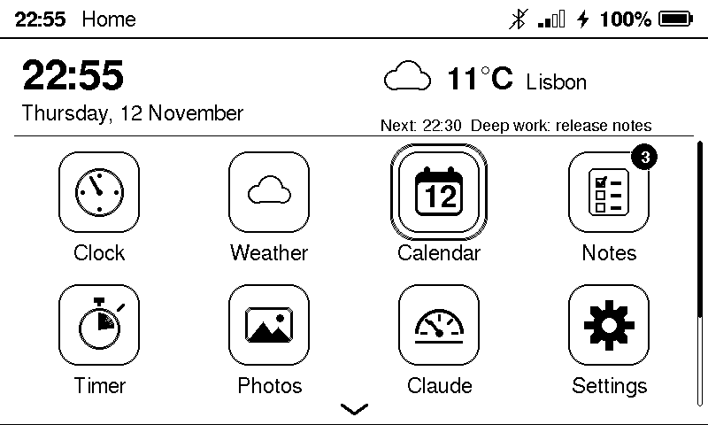
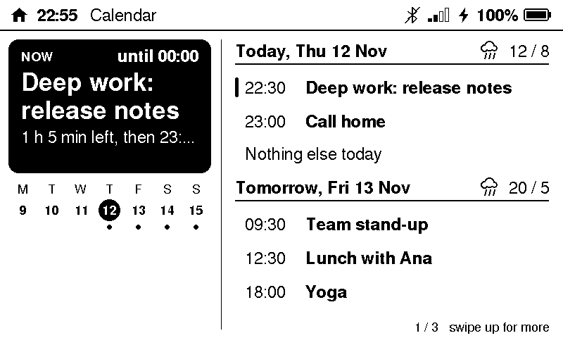
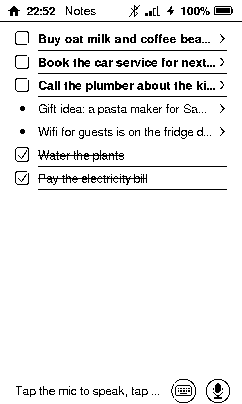
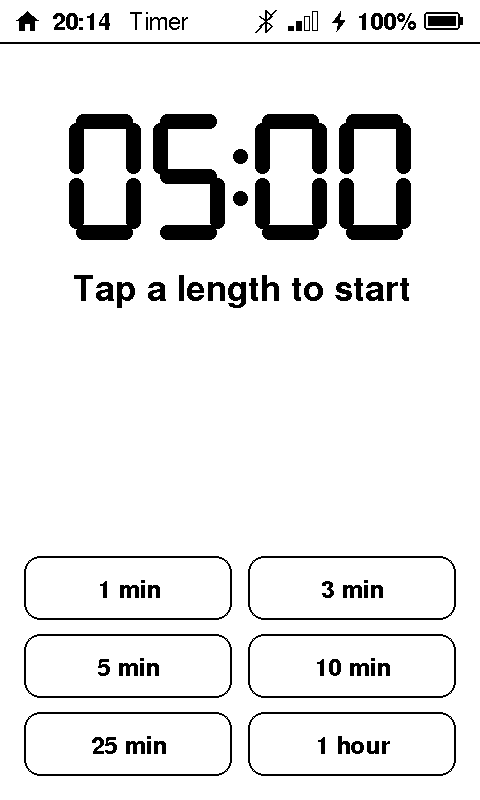
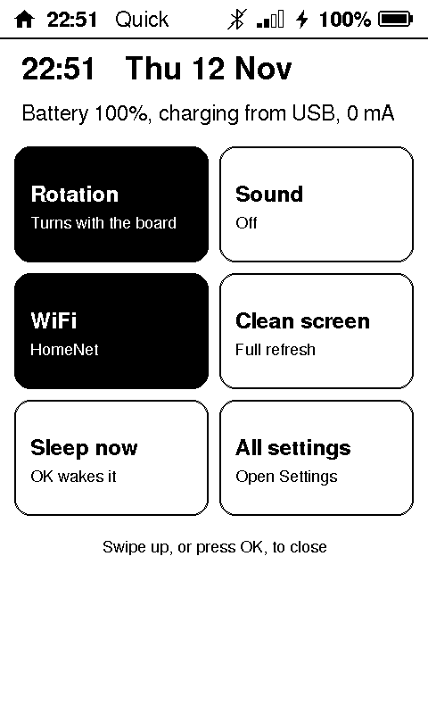
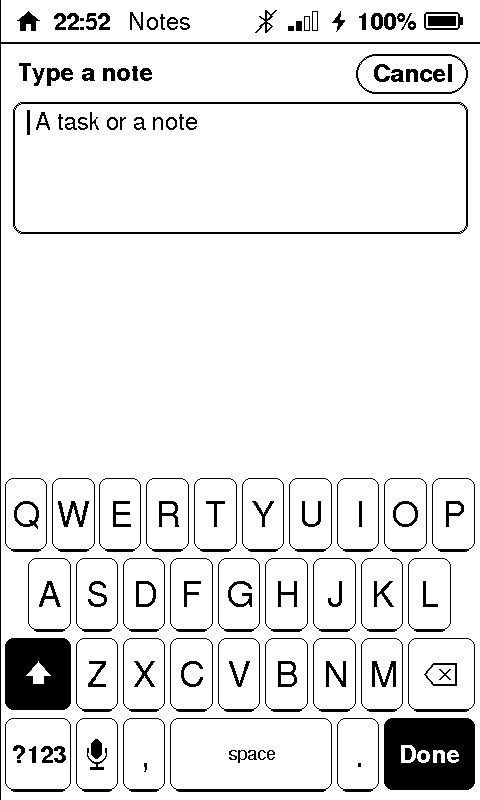

# Sticky OS

Sticky OS is a firmware for the [Seeed reTerminal Sticky](https://www.seeedstudio.com/sticky/), the 3.97" magnetic
touch e-paper board. It turns the board into a small app device: a home
screen of app icons, a status bar, quick settings, and twelve apps (clock,
weather, calendar, notes with voice, timer, photos, quote of the day,
recipes, a folder of games and more), made to be read at a glance from
across the room. Settings live on the board and are made from a setup app
in your browser, over USB or Bluetooth; nothing personal is built into the
firmware.

> An independent, open-source firmware for the Seeed reTerminal Sticky. Not
> made by or affiliated with Seeed Studio.

Website and setup app: **<https://sticky-os.space.fast/>**
The board itself: **<https://www.seeedstudio.com/sticky/>** (Seeed Studio)

  
  

  
  
  
  

## The apps

| App | What it does |
|---|---|
| Clock | Large time and date, indoor temperature and humidity |
| Weather | Now and five days, and any day's hours (Open-Meteo, no key needed) |
| Calendar | What's on now and next, the week, the agenda (your Google, iCloud or Outlook calendar's iCal link; or your InfluxDB) |
| Notes | Tasks and notes, typed or spoken; the AI sorts them (needs an OpenAI key) |
| Timer | A countdown that rings even with sounds off |
| Photos | Photos sent from the setup app, and JPEGs from a microSD card; double-tap for full screen |
| Quote | Quote of the Day from ZenQuotes, or the board's own list offline; double-tap for full screen |
| Recipes | Say or type a dish; the AI writes the recipe (needs an OpenAI key) |
| Games | 2048, Memory, Maths Quest, Daily maths, Quiz, Adventure, X and O |
| Claude | Your weekly Claude Code usage, from your own MQTT broker |
| Settings | Rotation, sound, sleep, WiFi, which apps show, software update |
| About | Firmware, memory, network, battery, sensors |

Everything is described in the [guide](docs/guide.md).

## Install

You flash Sticky OS once over USB; after that, updates come over WiFi.
Flashing replaces the firmware the board shipped with (see
[going back](docs/development.md#going-back-to-seeeds-firmware)).

1. Download `sticky-os-full.bin` (and `sticky-os-full.bin.sha256`) from the
   [latest release](https://github.com/ovidiul/sticky-os/releases/latest).
2. Install [esptool](https://docs.espressif.com/projects/esptool/) (needs
   Python 3):

       pip install esptool            # macOS, Linux
       py -m pip install esptool      # Windows

3. Plug the board into your computer with a USB-C cable that carries data,
   and flash it at address 0x0:

   **macOS / Linux**

       shasum -a 256 -c sticky-os-full.bin.sha256      # should say OK
       esptool --chip esp32s3 --baud 460800 write-flash 0x0 sticky-os-full.bin

   **Windows** (the port is the board's COM port in Device Manager)

       certutil -hashfile sticky-os-full.bin SHA256    # compare with the .sha256 file
       py -m esptool --chip esp32s3 --port COM5 --baud 460800 write-flash 0x0 sticky-os-full.bin

   esptool finds the port by itself on macOS and Linux; add
   `--port /dev/ttyACM0` (or `/dev/cu.usbmodem…`) if you have several.

The board restarts into Sticky OS when it's done. esptool puts the board in
download mode by itself through the USB-C port. If it can't connect: try
another cable or USB port, lower the speed (`--baud 115200`), close any
other program that has the port open (a serial monitor, the setup app), and
on Linux add yourself to the `dialout` group.

Want a copy of the original firmware first? Before step 3:
`esptool --chip esp32s3 read-flash 0 0x2000000 factory-32mb.bin` (32 MB,
a few minutes).

**In the browser instead:** Espressif's
[ESP Tool](https://espressif.github.io/esptool-js/) runs in Chrome or Edge
on a computer: *Connect*, pick the board's port, set the flash address to
`0x0`, choose `sticky-os-full.bin`, *Program*.

## Set up

The first start shows a welcome screen with the setup app's address and a
QR code. Open **<https://sticky-os.space.fast/setup/>** in Chrome or Edge on
a computer (Chrome on Android for Bluetooth) and connect:

- **over USB:** plug the board in and choose USB, or
- **over Bluetooth:** on the board, Settings → *Connect to the setup app*;
  it shows its name and a 6-digit code to type on the page.

The setup app runs in your browser and sends nothing anywhere but to your
board. In it:

- **WiFi:** the networks the board may join (you can also add one on the
  board, Settings → WiFi).
- **Weather:** found from the board's internet address, or a town you set.
- **Calendar** (optional): paste up to three calendars' secret iCal links,
  each with a label if you like. The board reads them itself every 30
  minutes, straight from the calendar service. Where to find the link:
  - *Google Calendar* (on a computer): Settings → pick the calendar under
    *Settings for my calendars* → *Integrate calendar* → **Secret address
    in iCal format**.
  - *iCloud*: in the Calendar app, the calendar's share button → turn on
    **Public Calendar** → copy the link (`webcal://…` is fine).
  - *Outlook / Microsoft 365*: Settings → Calendar → Shared calendars →
    **Publish a calendar** (*Can view all details*) → copy the ICS link.

  The link is a password to that calendar: the board keeps it and never
  sends it back. If one leaks, reset it in the calendar service.
- **OpenAI key** (optional): voice notes, dictation, sorting notes,
  recipes, and AI quizzes and stories. Everything else works without it.
  The requests go from the board straight to OpenAI (or a relay of your
  own), on your OpenAI account.
- **For power users** (optional): an MQTT broker (Claude usage, telemetry),
  InfluxDB (calendar events you write there yourself; merged with the
  links), your own CA, a relay on your network.
- **Photos:** crop, preview in the board's four greys, and send.

Passwords and keys can be written but never read back. Every setting is
listed in the [guide](docs/guide.md#the-settings).

## Updates

Settings → **Software update** on the board checks the project's GitHub
releases (once a day, and on *Check now*) and shows when a new version is
out; **Install** puts it on, checks it, and restarts. If a new version
doesn't start properly, the board goes back to the one before.

Installing by itself is **off by default** (releases aren't signed yet,
see [SECURITY.md](SECURITY.md)); turn on *Install updates automatically* in
the same place, or `update.auto` in the setup app, if you want it.

## Build from source

You need [arduino-cli](https://arduino.github.io/arduino-cli/), the ESP32
core 3.3.11 and three libraries:

    arduino-cli core update-index --additional-urls https://espressif.github.io/arduino-esp32/package_esp32_index.json
    arduino-cli core install esp32:esp32@3.3.11 --additional-urls https://espressif.github.io/arduino-esp32/package_esp32_index.json
    arduino-cli lib install "Adafruit BusIO@1.17.4" "Adafruit GFX Library@1.12.6" "PubSubClient@2.8"

    ./upload.sh build    # build only, into firmware/sticky-os/build
    ./upload.sh          # build and flash over USB

[docs/development.md](docs/development.md) has the rest: the hardware, the
flash layout, how updates and releases work. The setup protocol is in
[docs/protocol.md](docs/protocol.md); the website and setup app are in
`site/` (`node test/run.mjs` runs the setup app's tests); the calendar
parser's tests run on your computer with `firmware/test/ics/run.sh`.

## Contributing, security, licence

- [CONTRIBUTING.md](CONTRIBUTING.md): bugs, ideas, pull requests, the serial
  test commands.
- [SECURITY.md](SECURITY.md): how to report a problem privately, and what
  the board does and doesn't protect.
- [MIT licence](LICENSE). The screen and touch drivers in
  `firmware/sticky-os/src/sticky_drivers/` come from Seeed's open-source
  examples, also MIT.
